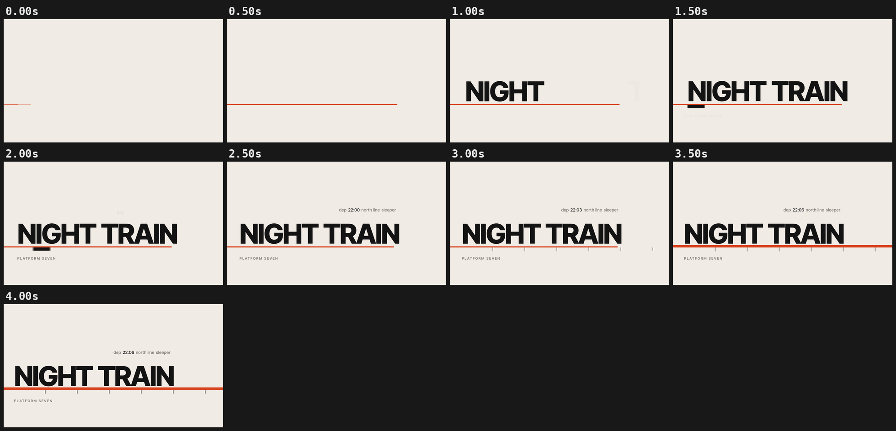

# frame-motion

Motion graphics from code, for AI agents. Your agent writes a scene as an HTML page and frame-motion renders it to a frame-perfect MP4, with optional motion blur, quality checks (contact sheets, beat sheets, pop/flash detection, loop seams, repeatability) and code-generated soundtracks.



*`examples/kinetic-title.html` ("NIGHT TRAIN", 4 s, 16:9, 120 BPM), one frame every 0.5 s.*

Sibling skill: [**data-dash**](https://github.com/venthewise/data-dash), traceable, self-contained HTML dashboards.

Use it for kinetic typography, explainers, animated charts, product walkthroughs, loops and launch films built from scratch. Don't use it to edit real footage (trim, overlay, caption). Use a video editor or a Remotion-based workflow for that, and composite frame-motion renders into it if you need custom graphics.

## Requirements

| What | Needed for | Notes |
|---|---|---|
| Python **3.10+** | everything | |
| `playwright` + Playwright Chromium | every scene command | |
| `pillow` (10.1+) | stills, sheets, labels | |
| `numpy` | motion blur, `pops`, `loop`, `determinism`, audio tools | |
| `ffmpeg` + `ffprobe` on PATH | `full`, `draft`, `parallel`, `sheet`/`pops` on videos, `audio`, `mux` | |
| Network | install only | rendering works offline (scenes must use local or data-URI assets) |

## Install (one time)

### macOS / Linux (bash)

```bash
# macOS:  brew install python ffmpeg
# Debian/Ubuntu:  sudo apt install -y python3 python3-pip python3-venv ffmpeg
python3 -m venv .venv && source .venv/bin/activate
python3 -m pip install playwright pillow numpy
python3 -m playwright install chromium            # Linux: add --with-deps for system libraries
```

### Windows (PowerShell)

```powershell
winget install -e --id Python.Python.3.12
winget install -e --id Gyan.FFmpeg          # ffmpeg + ffprobe on PATH (open a new terminal after)
py -3 -m venv .venv; .\.venv\Scripts\Activate.ps1
python -m pip install playwright pillow numpy
python -m playwright install chromium
```

On Windows use `python` (or `py -3`), not `python3`: `python3` may open the Microsoft Store alias. Commands in this README use `python3`; replace it with `python` on Windows. Paths with `/` work in PowerShell.

## Install for your agent

This repository **is** the skill: its root holds `SKILL.md` plus `scripts/`, `references/`, `examples/` and `assets/` (a standard [Agent Skills](https://agentskills.io/specification) folder). Install it by cloning or copying the repo folder into a skills directory your agent scans. The folder must be named `frame-motion` (it has to match `name:` in `SKILL.md`).

Get it:

```bash
git clone https://github.com/venthewise/frame-motion.git        # or download frame-motion.zip and unzip it
```


| Agent | Personal (all projects) | Project (commit to repo) | Invoke | Status |
|---|---|---|---|---|
| Claude Code | `~/.claude/skills/frame-motion/` (Windows: `%USERPROFILE%\.claude\skills\frame-motion\`) | `.claude/skills/frame-motion/` | auto, or `/frame-motion` | verified ([docs](https://code.claude.com/docs/en/skills), [.claude dir](https://code.claude.com/docs/en/claude-directory)) |
| Claude apps (claude.ai, desktop) | enable Settings → Capabilities → *Code execution and file creation*, then Customize → Skills → + → Create skill → Upload a skill, and pick `frame-motion.zip` (the release zip, with a top-level `frame-motion/` folder) | – | auto | upload steps verified ([help center](https://support.claude.com/en/articles/12512180-use-skills-in-claude)); whether Claude's sandbox has the Python packages, Chromium and ffmpeg it needs is **not verified** |
| OpenAI Codex (CLI, IDE extension, ChatGPT desktop app) | `$HOME/.agents/skills/frame-motion/` | `.agents/skills/frame-motion/` (any folder from CWD up to the repo root) | auto, `/skills`, or `$frame-motion` | verified ([docs](https://developers.openai.com/codex/skills)). `~/.codex/skills` is **not** listed in the Codex docs |
| Cursor | `~/.cursor/skills/frame-motion/` or `~/.agents/skills/frame-motion/` | `.cursor/skills/frame-motion/` or `.agents/skills/frame-motion/` | auto, or `/frame-motion` | verified ([docs](https://cursor.com/docs/skills)); also reads `.claude/skills` and `.codex/skills` |
| Gemini CLI | `~/.gemini/skills/frame-motion/` or `~/.agents/skills/frame-motion/` | `.gemini/skills/frame-motion/` or `.agents/skills/frame-motion/` (workspace must be trusted: `/trust`) | auto; check with `/skills list`, `/skills reload` | verified ([docs](https://github.com/google-gemini/gemini-cli/blob/main/docs/cli/skills.md), [tutorial](https://github.com/google-gemini/gemini-cli/blob/main/docs/cli/tutorials/skills-getting-started.md)) |
| Grok Build CLI (xAI) | `~/.grok/skills/frame-motion/` or `~/.agents/skills/frame-motion/` | `.grok/skills/frame-motion/` (walked up to the repo root) | auto, or `/frame-motion` | verified ([docs](https://docs.x.ai/build/features/skills-plugins-marketplaces)); also reads Claude Code skill folders |
| Other agents with Agent Skills support | the agent's skills folder | – | – | check the agent's docs |

**One folder for most agents:** `~/.agents/skills/` (or `.agents/skills/` in a repo) is read by Codex, Cursor, Gemini CLI and Grok Build. Claude Code reads `~/.claude/skills/`, which can be a symlink to the same folder.

macOS / Linux:
```bash
mkdir -p ~/.agents/skills ~/.claude/skills
git clone https://github.com/venthewise/frame-motion.git ~/.agents/skills/frame-motion   # or: cp -R frame-motion ~/.agents/skills/
ln -s ~/.agents/skills/frame-motion ~/.claude/skills/frame-motion                         # optional: Claude Code
```

Project-scoped instead: clone or copy it to `.agents/skills/frame-motion` (or `.claude/skills/frame-motion`, `.cursor/skills/frame-motion`, `.gemini/skills/frame-motion`, `.grok/skills/frame-motion`) inside your repo.

Windows PowerShell:
```powershell
New-Item -ItemType Directory -Force "$HOME\.agents\skills", "$HOME\.claude\skills" | Out-Null
git clone https://github.com/venthewise/frame-motion.git "$HOME\.agents\skills\frame-motion"   # or Copy-Item -Recurse .\frame-motion ...
Copy-Item -Recurse -Force "$HOME\.agents\skills\frame-motion" "$HOME\.claude\skills\"    # Claude Code (or use a junction)
```

Restart the agent (or reload skills) after installing.

### Agents without skill support

The skill still works: it is plain Markdown plus Python scripts.

- **Point the agent at it:** "Read `path/to/frame-motion/SKILL.md` and follow it for this task. Run its scripts from that folder."
- **Or reference it in `AGENTS.md`** (read by Codex, Cursor, Gemini CLI, Grok Build and others) or your agent's rules file:

```markdown
## Skills
- frame-motion: see `tools/frame-motion/SKILL.md`. Read it before any task it describes, and
  run its scripts with paths relative to that folder (`tools/frame-motion/scripts/...`).
```

- **Chat-only assistants** (no shell): paste `SKILL.md` as instructions; the assistant can write the spec/scene, and you run the commands locally.

## Quick start

From the skill folder (`cd frame-motion`):

```bash
# 4 key stills (default size 1920x1080)
python3 scripts/render.py probe examples/kinetic-title.html 0.5 1.5 2.5 3.9 --out out/probe

# repeatability check (same time, same pixels)
python3 scripts/render.py determinism examples/kinetic-title.html --times 1.3,3.1

# fast half-res preview, then the final render with motion blur
python3 scripts/render.py draft examples/kinetic-title.html out/draft.mp4 --duration 4
python3 scripts/render.py full  examples/kinetic-title.html out/title.mp4 --duration 4 --fps 60 --sub 3 --shutter 0.5

# contact sheet of the result
python3 scripts/render.py sheet out/title.mp4 --every 0.5 --duration 4 --out out/sheet.png
```

Vertical? Add `--preset 9:16` to every command (the default is 16:9, 1920x1080). Every scene command prints the size it uses first.

With an agent, just ask: *"Use frame-motion to make a 10-second 16:9 kinetic title for 'Night Train' at 120 BPM, with a contact sheet."*

## Scene contract

```html
<div id="stage"><!-- your 1920x1080 scene --></div>
<script>
window.seek = async function (t) {   // seconds; sync or async, the renderer awaits it
  // draw the ENTIRE frame for exactly t: no Date, no timers, no rAF loops, no state from the last frame
};
document.fonts.ready.then(() => { window.ready = true; });
</script>
```

Seeded PRNG only (never `Math.random`). GSAP, Web Animations, Lottie, anime.js, Canvas, WebGL (`--webgl`), SVG and `<video>` can all be driven from `seek(t)`; see [`SKILL.md`](SKILL.md) and [`references/motion-patterns.md`](references/motion-patterns.md) (easing, critically damped springs, log-space zoom, velocity blur, object handoff, beat helpers).

## Commands

`python3 scripts/render.py <command> -h` shows every flag.

| Command | What it does |
|---|---|
| `probe HTML T [T ...]` | stills named by time (`t_01.50s.png`) |
| `poster HTML OUT.png [--t 0]` | one still / thumbnail |
| `sheet HTML\|VIDEO --times a,b \| --every S --duration D` | labelled contact sheet |
| `beats HTML --bpm B --duration D` | one labelled frame per beat + sheet |
| `draft HTML OUT.mp4 --duration D` | half-res (same layout), 30 fps, JPEG captures, fast |
| `full HTML OUT.mp4 --duration D [--fps] [--sub N --shutter S --cuts t1,t2]` | final render, optional motion blur |
| `parallel HTML OUT.mp4 --duration D --jobs N` | `full` split over N browser processes, joined losslessly |
| `pops VIDEO\|HTML [--bpm B]` | frame-diff spikes and single-frame flashes, tagged on/off beat |
| `loop HTML --duration D` | loop-seam check (position and velocity) |
| `determinism HTML --times a,b` | seek a, b, a and require identical pixels |
| `audio render AUDIO.html OUT.wav --duration D` | renders the scene's `window.renderAudio(duration, rate)` soundtrack to WAV |
| `audio peak / drop / loudnorm` | transient time (`--align T`), music drop, two-pass loudness to −14 LUFS |
| `mux VIDEO AUDIO OUT.mp4 [--sfx file@t:gain] [--lufs -14]` | add music + SFX, normalise, copy video |

Scene flags: `--preset 16:9|9:16|4:5|1:1` (1920x1080 default, 1080x1920, 1080x1350, 1080x1080), `--width/--height`, `--device-scale`, `--webgl`, `--no-harden`. Video flags: `--fps` (30), `--crf` (16), `--jpeg`, `--start`, `--x264-preset`, `--x264-threads`.

## Sandbox notes

- **Network:** some agents run commands with network off by default (for example Codex's default `workspace-write` sandbox, [docs](https://learn.chatgpt.com/docs/agent-approvals-security)). Only installing needs network (`pip install`, `playwright install chromium`, ffmpeg). Run those yourself or approve them; rendering is offline.
- **Chromium:** every scene command launches headless Chromium. Some sandboxes block it (missing system libraries or OS sandbox restrictions). On Linux, use `python3 -m playwright install --with-deps chromium`; if it still fails inside the agent sandbox, run the render command outside it.
- **CPU/RAM:** `parallel` starts one Chromium + one x264 per job; lower `--jobs` in small containers.

## Troubleshooting

| Problem | Fix |
|---|---|
| `ffmpeg not found` | install ffmpeg (Windows: `winget install -e --id Gyan.FFmpeg`, then open a new terminal) |
| Wrong size / vertical output expected | the default is 1920x1080; pass `--preset 9:16` on every command |
| Frame shows undrawn or old state | make `seek` return its Promise (`async`); the renderer awaits it |
| `determinism` FAIL | state leaks between frames: reset everything inside `seek`, no accumulation |
| WebGL / three.js renders black | `--webgl`, and `preserveDrawingBuffer: true` |
| Text missing | set `window.ready` only after fonts load; use local or data-URI fonts |
| `loop` velocity FAIL | ease both sides of the seam with the same velocity |
| `parallel` runs out of memory | lower `--jobs` |
| `python3` not found / opens the Store (Windows) | use `python` or `py -3` |

Fonts: the example asks for "Inter Tight" and falls back to Inter, Helvetica Neue or Arial if it isn't installed, so frames can differ slightly between machines. For pixel-identical renders everywhere, embed the font as a data URI in the scene.

## License

MIT, see [`LICENSE`](LICENSE). No third-party code or fonts are bundled.

## Credits

- Author: Paolo Libertad ([@venthewise](https://github.com/venthewise)). See also the sibling skill [data-dash](https://github.com/venthewise/data-dash).
- Inspired by Anthropic's Claude Motion; an independent project, not affiliated with Anthropic.
